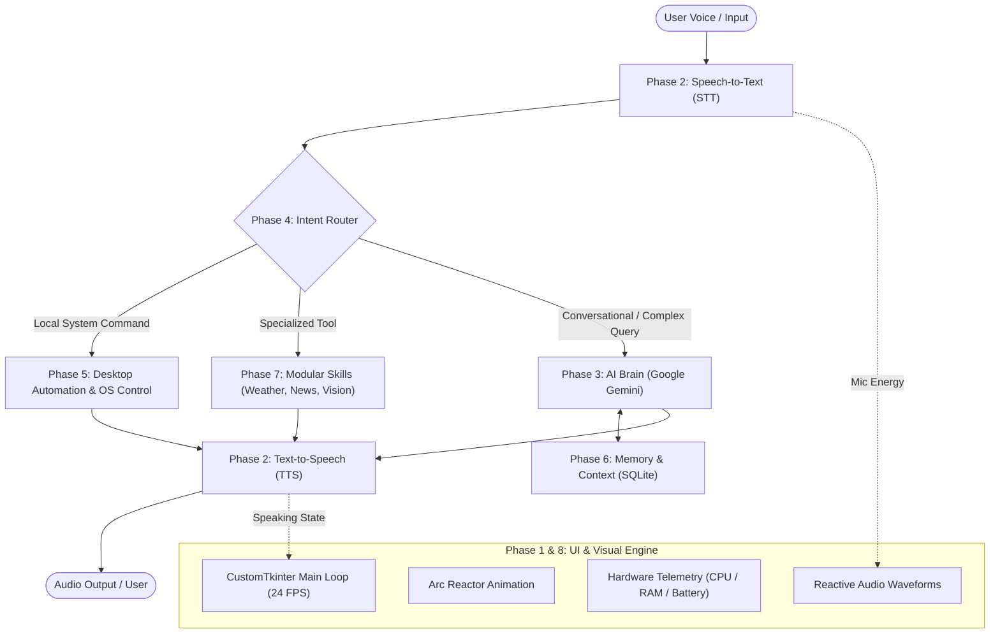
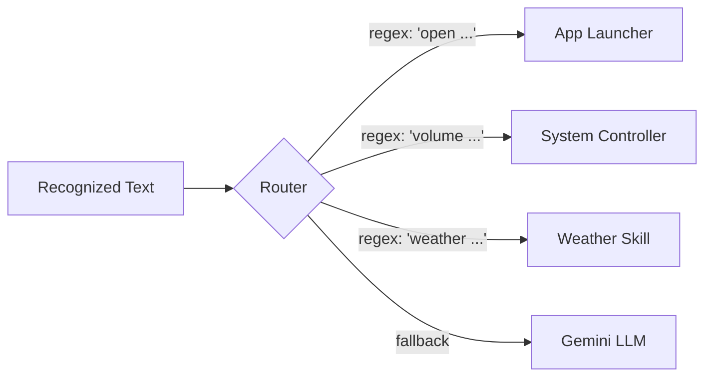

# J.A.R.V.I.S. Architectural Guide & Phase Explanations

This document serves as your complete learning reference for the design, architecture, computer science concepts, and mechanics behind each development phase of J.A.R.V.I.S.

---

## High-Level Architecture Overview

J.A.R.V.I.S. is built on an **event-driven, multi-threaded asynchronous architecture**. Instead of running everything in one linear script, separate specialized subsystems communicate through thread-safe queues and message callbacks.



---

## Phase 1: Core Foundation & UI Architecture

### 1. The Core Problem Solved
A modern AI assistant needs an interactive dashboard, but rich interfaces are heavy. If graphics, animations, or metric checks run inefficiently, the app stutters or locks up. Phase 1 establishes the rock-solid graphical and system foundation.

### 2. Key Concepts & Computer Science Principles
- **The Event Loop (`mainloop()`)**: Desktop graphical interfaces don't run line-by-line; they loop continuously at high speed, redrawing pixels and checking for keyboard/mouse events.
- **Non-Blocking Scheduling (`after()` vs `time.sleep()`):**
  - Calling `time.sleep(1)` halts the entire CPU thread, freezing the window and causing Windows to report the app as "Not Responding".
  - Using `widget.after(ms, callback)` asks Tkinter to schedule an event in the future while letting the event loop continue drawing frames in the meantime.
- **Pre-rendered Frame Sequencing:** Rather than rendering heavy vector math or rasterizing complex JSON layers at runtime, we pre-generate 192 transparent PNG frames and cycle them through a lightweight `CTkImage` cache at 24 FPS (~41 ms per frame).
- **Graceful Lifecycle & Signal Handling:**
  - Standard applications often leave zombie processes or open sockets when closed.
  - Phase 1 binds the window manager's `WM_DELETE_WINDOW` protocol and catches terminal `KeyboardInterrupt` (Ctrl+C), ensuring all timers are cancelled and memory is released before `window.destroy()`.

### 3. Key Files
- `core/app.py`: State controller coordinating startup, runtime, and shutdown.
- `core/app_state.py`: Explicit state enum (`STARTING`, `READY`, `LISTENING`, `SPEAKING`, etc.).
- `ui/main_window.py`: Sci-fi themed CustomTkinter window, circular canvas meters, and Arc Reactor animation loop.
- `config.py`: Single source of truth for configuration and `pathlib.Path` directory anchors.
- `utils/logger.py`: Dual-output logging (simultaneous console + file logging).

---

## Phase 2: Speech & Audio Subsystem

### 1. The Core Problem Solved
Voice is the primary human interface with J.A.R.V.I.S. This phase gives J.A.R.V.I.S. "ears" (Speech-to-Text) and "mouth" (Text-to-Speech) without freezing the user interface.

### 2. Key Concepts & Computer Science Principles
- **Producer-Consumer Concurrency Pattern:**
  - The UI or AI produces sentences to speak.
  - A thread-safe First-In, First-Out Queue (`queue.Queue`) holds pending speech requests.
  - A dedicated background daemon thread consumes items one by one and plays them.
- **Windows COM Multithreading (`CoInitialize`):**
  - Windows SAPI5 audio engines rely on the Component Object Model (COM). COM rules dictate that each separate operating system thread using COM must initialize its own COM state via `CoInitialize()` and clean it up via `CoUninitialize()`.
- **Microphone Signal Processing:**
  - Ambient Noise Calibration: Analyzes background room noise for 1 second to calculate a dynamic energy threshold, distinguishing real speech from air conditioning or typing.
  - Voice Activity Detection (VAD): Distinguishes silence from active human speech, cutting off recording once a pause threshold (e.g. 0.8s) is reached.
- **Thread-Safe UI State Synchronization:**
  - Background audio threads notify the UI when speech begins or ends using `self.window.after(0, ...)`, avoiding thread race conditions.

### 3. Key Files
- `speech/tts.py`: Thread-safe, non-blocking Text-to-Speech engine wrapping `pyttsx3`.
- `speech/stt.py`: Background microphone listener with automatic noise adjustment wrapping `SpeechRecognition`.
- `speech/audio_stream.py`: Real-time audio amplitude capture feeding live waveforms into the GUI.

---

## Phase 3: AI Brain & LLM Integration

### 1. The Core Problem Solved
Hardcoded if-else statements make an assistant feel like a rigid script. Phase 3 connects J.A.R.V.I.S. to Google Gemini, giving it advanced reasoning, problem-solving, and conversational intelligence.

### 2. Key Concepts & Computer Science Principles
- **System Prompts & Persona Priming:**
  - By injecting a specialized system instruction at initialization, we instruct the model to adopt the concise, witty, British-toned, loyal persona of J.A.R.V.I.S.
  - Enforces speech-optimized outputs (short, punchy sentences instead of long Markdown essays that sound awkward when read aloud).
- **Streaming Responses (Chunk Processing):**
  - Instead of waiting 4 seconds for a full paragraph to generate before speaking, tokens stream in real time. J.A.R.V.I.S. can begin speaking the first sentence while the second sentence is still being computed.
- **Graceful Network Degradation:**
  - If the user is offline or the API key hits a rate limit, the system falls back to local responses without crashing.

### 3. Key Files
- `ai/gemini_client.py`: Client interfacing with the modern Google GenAI SDK.
- `ai/prompts.py`: Persona instructions, system constraints, and few-shot formatting rules.
- `ai/agent.py`: High-level conversational agent handling multi-turn message dispatch.

---

## Phase 4: Intent Recognition & Action Routing

### 1. The Core Problem Solved
Not every user sentence should be sent to the cloud. Asking *"What time is it?"* or *"Mute volume"* should execute instantly in milliseconds on your local machine for zero cost and zero latency.

### 2. Key Concepts & Computer Science Principles
- **Intent Classification (Rule-Based vs. Semantic):**
  - **Fast-Path (Deterministic Regex/Keywords):** Checks for obvious patterns (e.g., `^open (.*)`, `^volume (up|down)`, `^mute$`). Execution time: < 1 ms.
  - **Slow-Path (LLM Semantic Reasoning):** If no deterministic pattern matches, the query routes to Gemini to understand ambiguous or complex queries.
- **The Command Dispatcher / Router Pattern:**
  - Decouples the speech listener from the execution engines. The listener only extracts text; the router determines who handles it (`SystemController`, `AppLauncher`, `Skill`, or `LLM`).



### 3. Key Files
- `nlp/intent_classifier.py`: Evaluates spoken input against registered intents and keyword patterns.
- `core/router.py`: Central dispatcher mapping classified intents to specific executable functions.

---

## Phase 5: Desktop Automation & System Control

### 1. The Core Problem Solved
Transforms J.A.R.V.I.S. from a conversational chatbot into a true desktop companion capable of controlling Windows applications, multimedia, and hardware settings.

### 2. Key Concepts & Computer Science Principles
- **OS Subprocessing & Application Discovery:**
  - Launching Windows applications using `subprocess.Popen` without hanging the assistant.
  - Mapping common voice aliases ("code" $\rightarrow$ `code.exe`, "browser" $\rightarrow$ `chrome.exe`) via a lookup dictionary.
- **Windows Core Audio APIs (WASAPI):**
  - Communicating directly with the Windows audio hardware endpoint via `pycaw` to adjust master volume levels or toggle mute programmatically.
- **Virtual Keystrokes & Media Keys:**
  - Simulating media keys (`VK_MEDIA_PLAY_PAUSE`, `VK_MEDIA_NEXT_TRACK`) to control Spotify, YouTube, or VLC playback globally.
- **Browser Automation:**
  - Opening URLs, generating formatted search links (e.g., `https://www.google.com/search?q=...`), and launching video streams directly.

### 3. Key Files
- `automation/app_launcher.py`: Resolves application names and executes Windows binaries.
- `automation/browser.py`: Browser search and website navigation handlers.
- `system/audio_controller.py`: System master volume and mute controls using Windows audio endpoints.
- `system/power_controller.py`: Screen lock, sleep, and cancelable shutdown functions.

---

## Phase 6: Memory, Persistence & Context

### 1. The Core Problem Solved
Without memory, J.A.R.V.I.S. forgets who you are the second a command finishes. Phase 6 gives J.A.R.V.I.S. both working session memory and long-term memory across restarts.

### 2. Key Concepts & Computer Science Principles
- **Short-Term Context Window:**
  - A rolling message history (e.g., last 10 messages) passed into Gemini so you can ask follow-up questions:
    - *User:* "Who directed Inception?"
    - *J.A.R.V.I.S.:* "Christopher Nolan."
    - *User:* "What other movies has he made?" *(J.A.R.V.I.S. understands "he" refers to Christopher Nolan).*
- **Relational Persistence (SQLite):**
  - Storing user preferences, past commands, custom notes, and user facts in a lightweight local SQLite database.
  - Fast, serverless, transactional, and stored directly in your project folder (`database/jarvis.db`).

### 3. Key Files
- `memory/short_term.py`: Ring-buffer holding active conversation turns.
- `database/db_manager.py`: SQLite connection manager, table migrations, and CRUD helpers.
- `memory/long_term.py`: High-level interface to store and retrieve personal user facts.

---

## Phase 7: Modular Skills & Multimodal Vision

### 1. The Core Problem Solved
Adds specialized abilities (weather, news, timers) and eyes (vision) without bloating the core application code.

### 2. Key Concepts & Computer Science Principles
- **Plugin / Skill Architecture:**
  - Each skill is an isolated module implementing a standard interface (`can_handle(query)` and `execute(query)`). New features can be added by dropping a file into `skills/` without touching `main.py`.
- **Free REST API Consumption:**
  - Interfacing with open endpoints (e.g. Open-Meteo for live forecasts, RSS feeds for news).
- **Multimodal AI & Screen Capture:**
  - Captures the active monitor using `Pillow.ImageGrab`.
  - Encodes the image bytes into Base64 format and submits it alongside a user prompt to Gemini Vision.
  - Allows commands like: *"Jarvis, what error is showing on my screen?"*

### 3. Key Files
- `skills/weather_skill.py`: Real-time weather and temperature reports.
- `skills/news_skill.py`: Top headline aggregation.
- `skills/reminder_skill.py`: Timers and alarms triggering audio alerts.
- `vision/screen_capture.py`: Desktop screen capture and image encoding for Gemini.

---

## Phase 8: Final Polish, Audio Reactivity & Packaging

### 1. The Core Problem Solved
Brings all pieces into a unified, visually stunning desktop experience and bundles the project into a distributable Windows executable.

### 2. Key Concepts & Computer Science Principles
- **Audio-Reactive Visuals:**
  - Mathematical Fast Fourier Transform (FFT) or Root Mean Square (RMS) amplitude calculation converting live microphone/speaker audio into dynamic waveform height and pulsing Arc Reactor glows.
- **Hands-Free Wake Word Detection:**
  - Lightweight local acoustic model listening in the background for *"Jarvis"* with ultra-low CPU usage (< 1%).
- **Executable Freezing (PyInstaller):**
  - Compiling the Python interpreter, dependencies (`customtkinter`, `pillow`, `psutil`), and assets (`frames`, `icons`, `sounds`) into a standalone Windows `.exe`.

---

## Summary of the Complete Request Lifecycle

When you speak: **"Jarvis, what's the weather in New York and open Chrome"**

```text
1. [Phase 2] Microphone captures audio -> Speech-to-Text converts soundwaves to string.
2. [Phase 4] Router analyzes string -> Detects two distinct actions (Skill: Weather, Automation: Launch Chrome).
3. [Phase 7] Weather Skill queries Open-Meteo API -> "It is 18°C and partly cloudy in New York."
4. [Phase 5] App Launcher locates Chrome binary -> subprocess.Popen starts Chrome.
5. [Phase 2] TTS background queue receives: "It's 18 degrees in New York, and I've opened Chrome for you."
6. [Phase 1 & 8] UI status shifts to SPEAKING, Arc Reactor glows, audio waveform animates, text logs to right panel.
```

