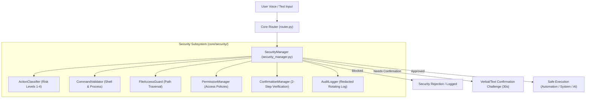
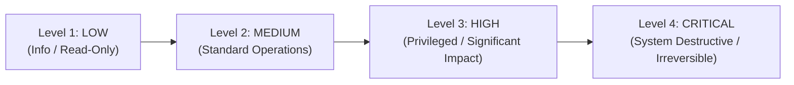

# J.A.R.V.I.S. Security Architecture & Policy Guide

This document outlines the security architecture, policy enforcement mechanisms, and developer guidelines for the **J.A.R.V.I.S. Desktop AI Voice Assistant**.

---

## 1. Security Overview & Philosophy

J.A.R.V.I.S. is an AI-powered voice assistant capable of controlling desktop applications, Windows system tasks, and automation workflows. Because AI models can be unpredictable, hallucinate, or be manipulated through prompt injection, **all security enforcement is implemented outside the AI model**.

### Core Tenet: Defense-in-Depth & Zero-Trust
1. **Never trust AI output blindly:** Every action proposed by the LLM or voice command pipeline must pass through strict, deterministic Python validation guards before execution.
2. **Deterministic Allowlisting:** System actions, application launches, and file operations use strict allowlists and canonical paths rather than open execution.
3. **Interactive Confirmation for Destructive Actions:** Irreversible or high-impact operations (e.g., shutdown, restart, file deletion, emptying recycle bin) require explicit user confirmation.
4. **Data Privacy First:** Speech audio is processed on-demand without covert background spooling, and secrets/credentials are redacted from memory and logs.

> [!NOTE]
> No application connected to natural language interfaces can claim 100% security. J.A.R.V.I.S. uses rigorous defense-in-depth layers to minimize attack surfaces and prevent unauthorized access or system damage.

---

## 2. Security Package Architecture (`core/security/`)

The security subsystem is centralized within the `core/security/` module. The diagram below illustrates how commands flow through the security guards:



### Component Breakdown

| Module | Primary Responsibility |
|---|---|
| **`security_manager.py`** | Central orchestrator. Evaluates actions, checks permissions, validates paths/commands, manages challenges, and logs audit events. |
| **`action_classifier.py`** | Evaluates risk levels (Level 1 Low to Level 4 Critical) based on intent and payload. |
| **`command_validator.py`** | Sanitizes commands, prevents shell injection, blocks metacharacters, and protects Windows OS & JARVIS processes from termination. |
| **`file_access_guard.py`** | Canonicalizes file paths, prevents directory traversal (`../`), restricts access to user folders, and blocks dangerous executable extensions. |
| **`confirmation_manager.py`** | Manages high-risk confirmation tokens with 30-second sliding expiration to prevent accidental or replay-triggered actions. |
| **`permission_manager.py`** | Enforces least-privilege policies (`STRICT`, `BALANCED`, `PERMISSIVE`). |
| **`tool_registry.py`** | Registers allowed tools with explicit permission categories (`READ_ONLY`, `WRITE`, `SYSTEM_CONTROL`, `DESTRUCTIVE`). |
| **`audit_logger.py`** | Rotates security logs (`logs/security_audit.log`, 5MB x 5 backups) and redacts API keys, tokens, and credentials. |

---

## 3. Four-Tier Risk Classification System

Every action or intent is mapped to one of four risk levels defined in `action_classifier.py`:



1. **Level 1 — Low Risk (No Confirmation Required):**
   - Read-only queries, general conversation, time/weather requests, volume adjustments, battery checks, reading clipboard.
2. **Level 2 — Medium Risk (Standard Operations):**
   - Opening trusted applications (Calculator, Notepad, Spotify), creating standard user folders in Desktop/Documents, taking screenshots, playing media.
3. **Level 3 — High Risk (Confirmation Required):**
   - Terminating non-critical user applications, system sleep, lock workstation, unverified application launches.
   - *Behavior:* JARVIS pauses execution and asks: *"Are you sure you want to [action]?"*
4. **Level 4 — Critical Risk (Strict Confirmation Required):**
   - System shutdown, system restart, emptying the recycle bin, file/folder deletion.
   - *Behavior:* Requires explicit verbal or text confirmation (`yes`, `confirm`, `proceed`). State automatically expires after 30 seconds.

---

## 4. Key Security Policies

### 4.1 Command Execution & Injection Prevention
- **No Arbitrary Commands:** JARVIS never passes arbitrary user input or AI output directly to `os.system()` or `subprocess.run(shell=True)`.
- **Blocked Shell Metacharacters:** Inputs containing `&`, `;`, `|`, `` ` ``, `$()`, or `>` are rejected by `CommandValidator`.
- **Protected Processes:** Critical Windows processes (`explorer.exe`, `csrss.exe`, `svchost.exe`, `lsass.exe`, `winlogon.exe`) and J.A.R.V.I.S. itself cannot be terminated.

### 4.2 File System Protection
- **Path Traversal Blocking:** File and folder operations use `pathlib.Path.resolve()` to normalize paths and ensure they remain inside allowed user directories (Desktop, Documents, Downloads).
- **Protected System Folders:** Access to `C:\Windows`, `C:\Windows\System32`, `C:\Program Files`, and root system drives is strictly blocked.
- **Blocked Executables:** Launching or downloading raw binary files (`.exe`, `.bat`, `.cmd`, `.vbs`, `.ps1`, `.scr`) through file automation is rejected.

### 4.3 Microphone Privacy & Voice Authentication
- **On-Demand Capture:** Microphone capture is initiated only during active listening cycles and cleanly released when stopped or paused.
- **No Covert Audio Spooling:** Audio data is stored in volatile memory buffers for speech-to-text processing and is never permanently written to disk or transmitted to unauthorized endpoints.
- **Voice Is Not Biometric Auth:** J.A.R.V.I.S. treats voice transcription strictly as untrusted text input. Voice alone cannot authorize Level 3 or Level 4 actions without an interactive confirmation challenge.
- **Replay Protection:** Confirmation tokens expire in 30 seconds, preventing recorded voice replay attacks from succeeding later.

### 4.4 Data Leakage & Credential Protection
- **No Hardcoded Secrets:** All API keys and secrets reside in the `.env` file, which is ignored by Git via `.gitignore`.
- **Automated Redaction:** `RedactingFormatter` in `utils/logger.py` and `core/security/audit_logger.py` uses regular expressions to replace API keys (`AIzaSy...`, `sk-...`, `Bearer...`) with `***REDACTED***`.
- **Clipboard Secret Shield:** When reading the clipboard aloud, J.A.R.V.I.S. checks for credentials or token patterns and suppresses reading them if sensitive data is detected.

### 4.5 Dependency & Supply Chain Security
- **Strictly Pinned Dependencies:** All 15 required dependencies in `requirements.txt` are pinned to exact versions with `==`.
- **No Implicit Upgrades:** Dependencies must not be updated loosely to prevent supply chain tampering or breaking API changes.

---

## 5. Security Testing & Verification

An automated security test suite comprising 20 scenarios (100 assertions) is located at `tests/test_security_suite.py`.

### Running the Security Test Suite

Run the test suite using the project virtual environment from PowerShell:

```powershell
Set-Location "c:\Users\LOQ\J.A.R.V.I.S"
$env:PYTHONPATH="."
.\venv\Scripts\python.exe -m unittest tests.test_security_suite -v
```

### Expected Output
```text
test_01_unauthorized_powershell_execution ... ok
test_02_arbitrary_cmd_execution ... ok
test_03_python_code_injection ... ok
test_04_path_traversal ... ok
test_05_deletion_outside_approved_directories ... ok
test_06_launching_unknown_executable ... ok
test_07_unauthorized_administrator_operations ... ok
test_08_destructive_operations_without_confirmation ... ok
test_09_unauthenticated_voice_requires_confirmation ... ok
test_10_recorded_voice_replay_timeout ... ok
test_11_microphone_stopped_state ... ok
test_12_ambient_speech_gated ... ok
test_13_direct_prompt_injection ... ok
test_14_indirect_prompt_injection ... ok
test_15_unauthorized_tool_invocation ... ok
test_16_memory_redaction ... ok
test_17_attempt_expose_api_key ... ok
test_18_pinned_dependencies ... ok
test_19_sensitive_info_in_audit_logs ... ok
test_20_bypass_prevention_alternative_pathways ... ok

----------------------------------------------------------------------
Ran 20 tests in ~20s

OK
```

---

## 6. Guidelines for Future Developers & AI Agents

When extending J.A.R.V.I.S. with new capabilities or tools:

1. **Register New Tools in `core/security/tool_registry.py`:**
   - Define exact parameters and assign the appropriate `ToolPermission` category (`READ_ONLY`, `WRITE`, `SYSTEM_CONTROL`, or `DESTRUCTIVE`).
2. **Never Call Shells Directly:**
   - Avoid `os.system()` and `subprocess.Popen(..., shell=True)`. Always use structured parameter lists and validate inputs with `CommandValidator`.
3. **Use `FileAccessGuard` for Any File I/O:**
   - Always validate destination directories and enforce canonical path checks before reading, writing, or deleting files.
4. **Preserve User Confirmation for Destructive Intents:**
   - If an action modifies system power states, deletes files, or terminates processes, route it through `SecurityManager.evaluate_action()` and check `needs_confirmation`.
5. **Run the Security Suite Before Committing:**
   - Always run `python -m unittest tests.test_security_suite` to ensure no security regressions were introduced.

---
*Maintained by the J.A.R.V.I.S. Development & Security Team.*

